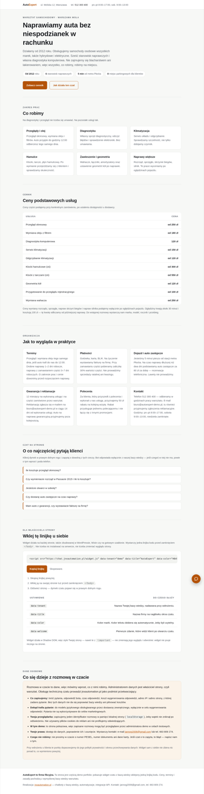
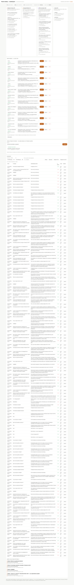

# Knowledge-base chatbot widget

A chat widget a business pastes into its site in one line. It answers only from the
company's own knowledge base, refuses to improvise, and records every question it
could not answer so the owner can fill the gap.

Live demo: **[chat.jnxautomation.pl/demo](https://chat.jnxautomation.pl/demo)** (fictional
car workshop, "AutoExpert"). The demo page shows the widget, the one-line embed and the
data-handling note a real client would see.



## What it does

- **One-line embed.** `<script src="…/widget.js" data-tenant="…" data-title="…">` on any
  page, including WordPress and Wix. No build step, no framework in the widget.
- **Answers from the knowledge base only.** The prompt is built from the tenant's own
  entries; the model is instructed to say it does not know rather than guess. Out-of-scope
  questions are logged as gaps, not answered.
- **Gap triage.** Unanswered questions are grouped into four buckets: *add to the base*,
  *client decision*, *filter, not the base* (prompt-injection attempts, price fishing),
  *noise* (typos, test strings). The owner sees what to fix and what to ignore.
- **Admin panel.** Password login, knowledge entries CRUD, test question, conversation
  log with per-answer latency and cost, thread view, CSV export of conversations and gaps.
- **Cost and latency visible.** Every answer records tokens, price per 1M tokens and the
  PLN conversion, so the monthly bill is a number, not a surprise.



## How it works

```
Browser widget  ──POST /api/chat──►  FastAPI
                                      ├── rate limit per IP (10 min window, daily cap)
                                      ├── knowledge base in SQLite (per tenant)
                                      ├── prompt: company data + rules + question
                                      ├── OpenRouter (model + fallback model)
                                      └── log: question, answer, tokens, cost, latency
Admin panel  ──/api/admin/*──►  knowledge CRUD, test, gaps, conversations, CSV
```

The widget and the admin panel are served by the same process; the database is a single
SQLite file on a mounted volume. One container per client, so a client's conversations
never mix with another's.

## Guardrails

- Allowed origins list, so the widget only answers on domains that may use it.
- Rate limit per IP and a daily cap, plus a maximum question length and token budget.
- The system prompt forbids disclosing itself, translating itself, or following
  instructions embedded in the question; injection attempts land in the "filter" bucket.
- No sensitive data requested or stored (no PESEL, ID numbers, card data).
- Cost ceiling per conversation, fallback model when the primary one is unavailable.

## Stack

Python 3.12, FastAPI, SQLite (standard library `sqlite3`), vanilla JavaScript widget,
Docker + docker-compose, nginx in front. No ORM, no frontend framework.

## Run locally

```bash
cp .env.example .env        # fill in OPENROUTER_API_KEY and the company data
docker compose up --build   # http://127.0.0.1:8090/demo and /admin
```

Or without Docker:

```bash
python3 -m venv .venv && .venv/bin/pip install fastapi uvicorn
.venv/bin/uvicorn app.main:app --reload --port 8090
```

`.env.example` documents every setting: model and fallback, prices, tenant and company
data, limits, allowed origins, admin password.

## Tests

```bash
.venv/bin/python -m pytest testy -q
```

`testy/test_app.py` and `testy/test_admin.py` cover the API, the rate limiter, the admin
flows and the CSV exports. `testy/przepusc-pulapki.py` replays a set of trap questions
(prompt injection, price fishing, off-topic) against a running instance and prints a
pass/fail table.

## Scope and limits

This is a single-tenant deployment per client, not a SaaS: one container, one SQLite file,
one knowledge base. Scaling to many clients means one container per client (which is how
it runs today) or moving the database to Postgres and the rate limiter to Redis. The demo
company is fictional; the widget, the panel and the measurements are real.

## License

MIT, see [LICENSE](LICENSE).

Built by [Jan Noga](https://jnxautomation.pl), jnxautomation.pl.
